<!-- markdownlint-disable MD033 MD041 -- a centred header needs HTML -->

# Etelier Ecommerce Website Demo


<!-- markdownlint-enable MD033 MD041 -->

A small online shop built with Spring Boot and Thymeleaf. Customers can browse and filter products, add them to a cart or buy one straight away, pay through Stripe and see their order history. An admin gets a sales dashboard with low-stock alerts, can filter and page through every order, ship or refund paid orders, and add, edit, hide or set pictures for products.

This project is an updated version of my web development [group project](https://github.com/jayengracio/webdev-ecommerce-project) for university. It was functional at best, but had a lot of issues in terms of security and general implementation in the backend. With this in mind, I decided this was a good place to start further practice and/or learning of new tech/tools. The framework was upgraded, the security, database and order model were rebuilt, real payments were added, the Bootstrap pages were rebuilt with Tailwind CSS and then redesigned as **Etelier**.

<!-- markdownlint-disable MD033 -- side-by-side screenshots need HTML -->

<p align="center">
  <a href="docs/screenshots/02-products.png">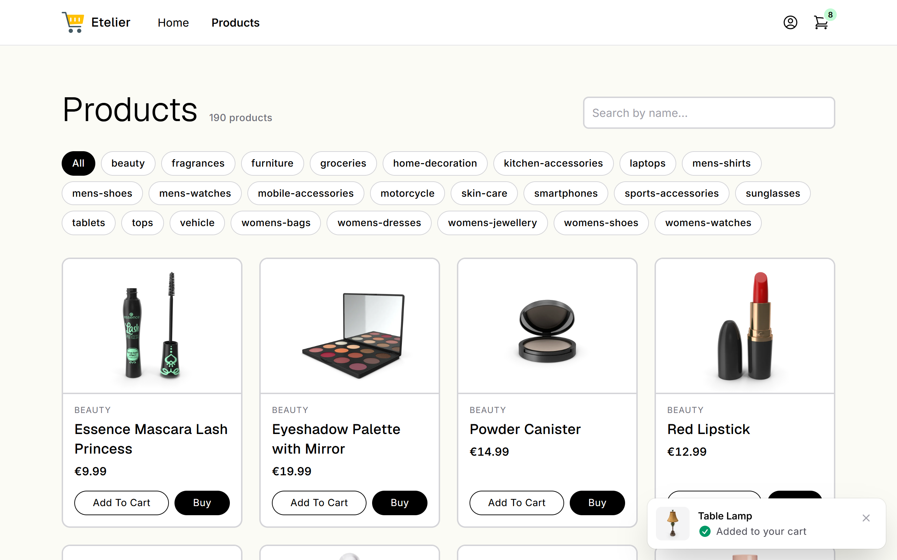</a>
  &nbsp;
  <a href="docs/screenshots/14-products-mobile.png">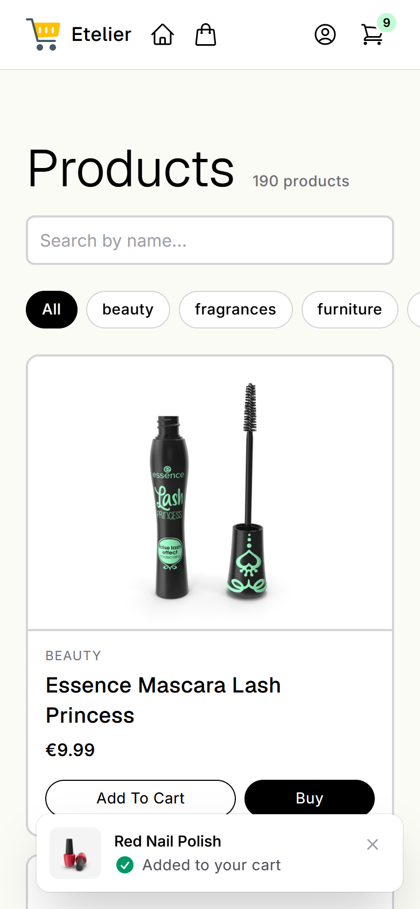</a>
</p>

<p align="center"><sub>The catalogue on a desktop and on a phone</sub></p>

<details>
<summary><strong>More Screenshots</strong>: Every page of the shop and the admin area</summary>

<br>

Taken with the demo data. Click an image for full size.

<h4>🛍️ Customer pages</h4>

| | |
| :---: | :---: |
| [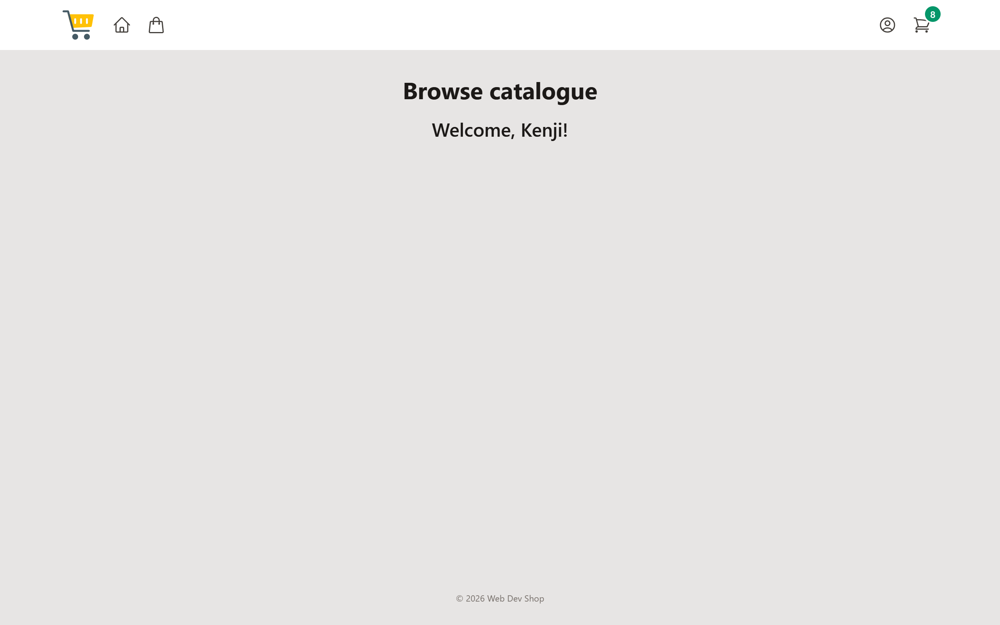](docs/screenshots/01-home.png)<br>**Home** · `/` | [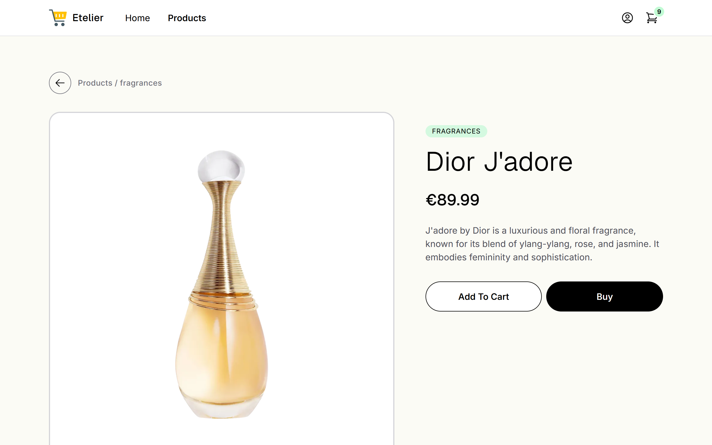](docs/screenshots/03-product-details.png)<br>**Product details** · `/details/{id}` |
| [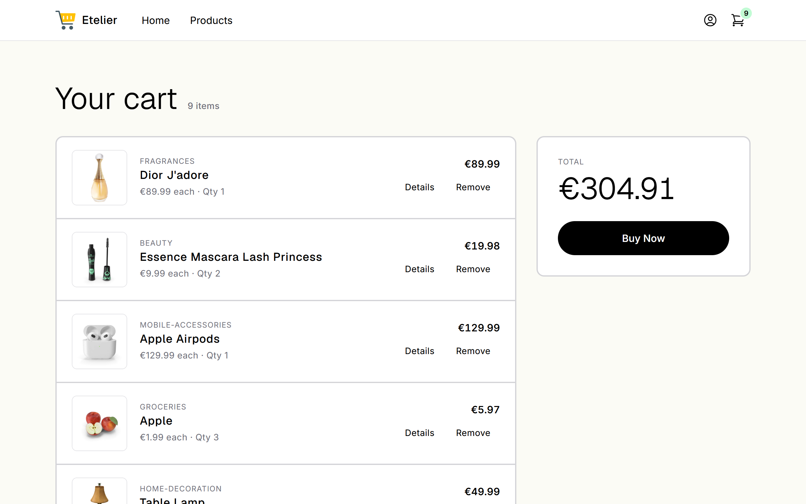](docs/screenshots/04-cart.png)<br>**Cart** · `/cart` | [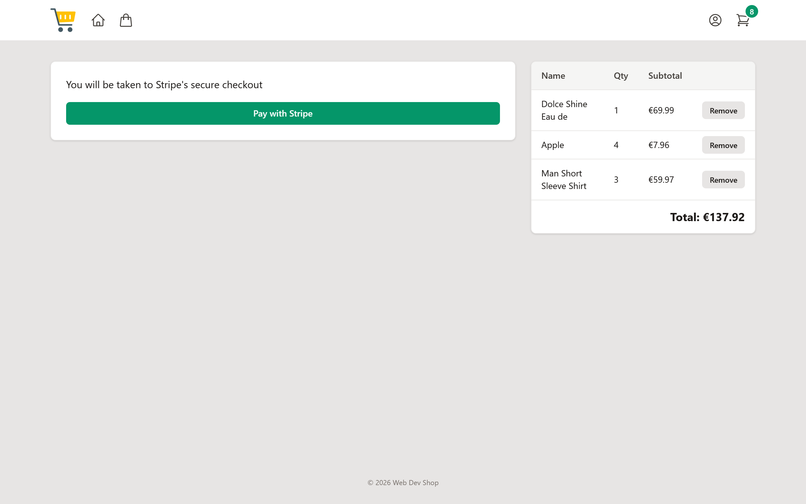](docs/screenshots/05-checkout.png)<br>**Checkout** · `/checkout` |
| [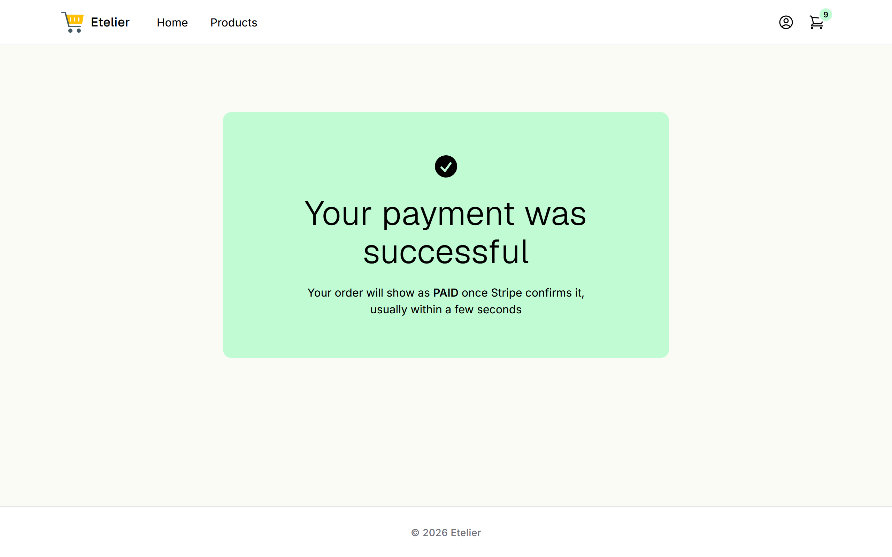](docs/screenshots/06-purchase-success.png)<br>**Payment received** · `/purchase` | [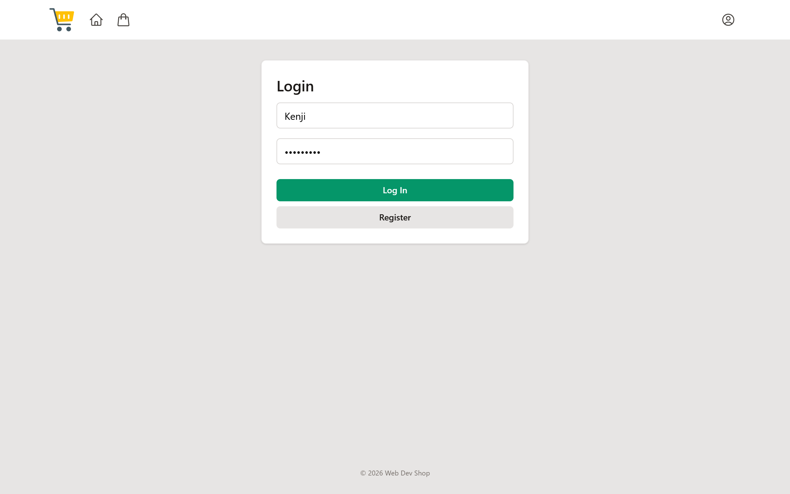](docs/screenshots/07-login.png)<br>**Log in** · `/login` |
| [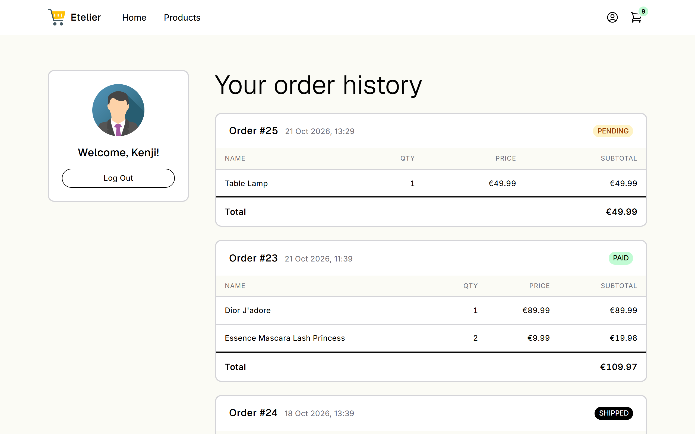](docs/screenshots/08-profile.png)<br>**Order history** · `/profile` | |

<h4>🛠️ Admin-exclusive pages</h4>

| | |
| :---: | :---: |
| [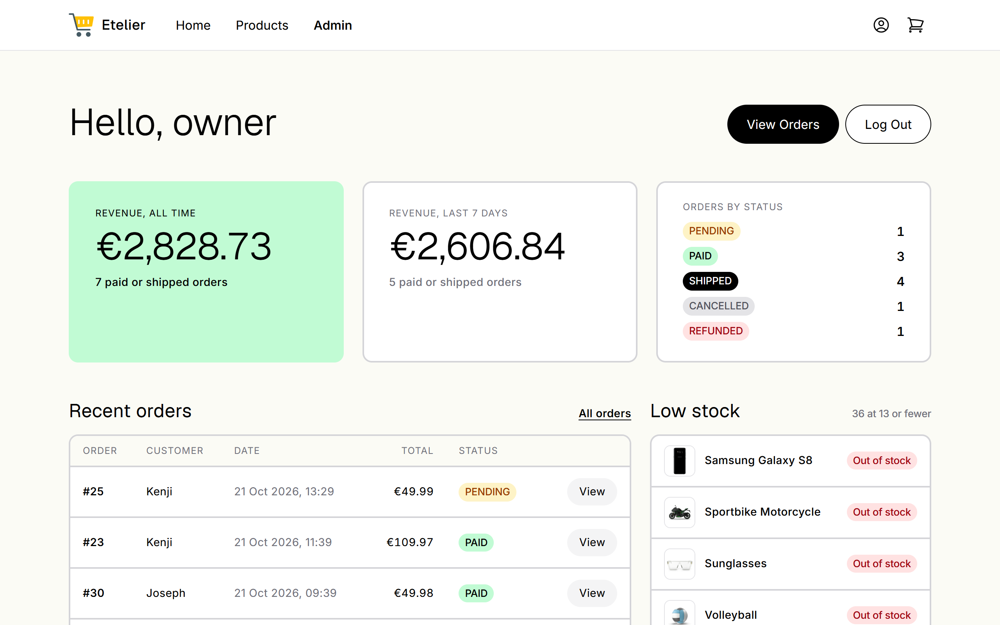](docs/screenshots/09-admin-dashboard.png)<br>**Dashboard** · `/owners` | [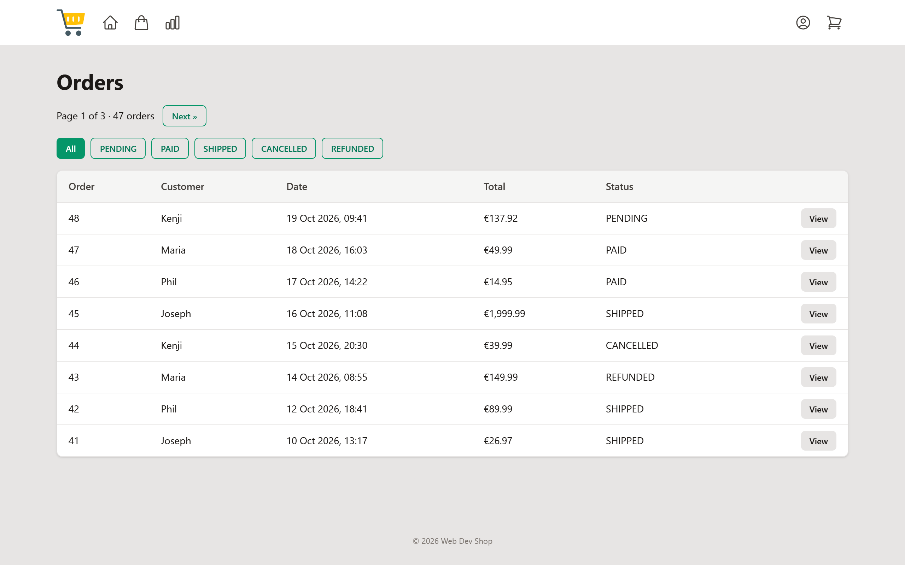](docs/screenshots/10-admin-orders.png)<br>**Orders** · `/view/orders` |
| [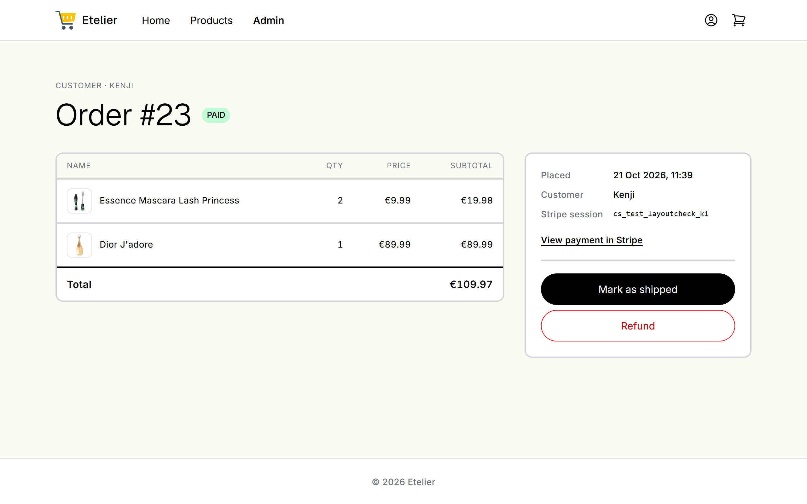](docs/screenshots/11-admin-order.png)<br>**Order** · `/orders/{id}` | [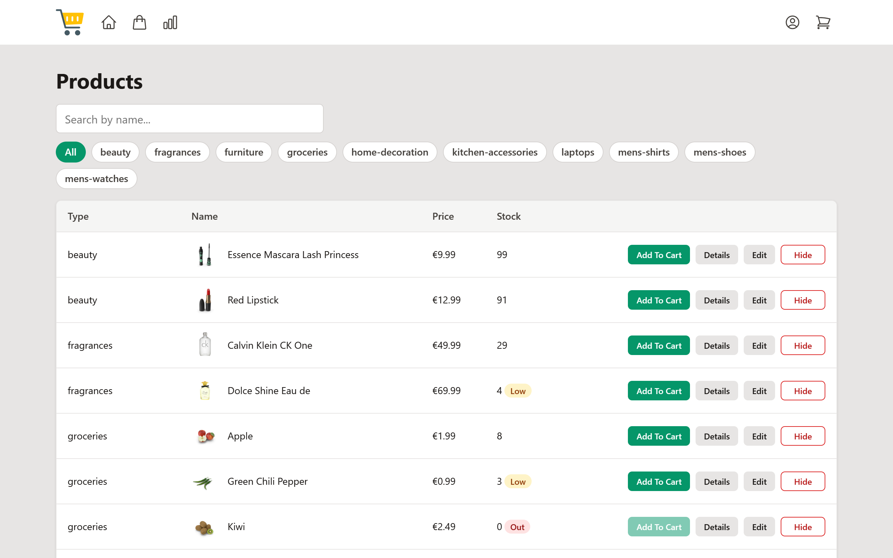](docs/screenshots/12-admin-products.png)<br>**Manage products** · `/products` |
| [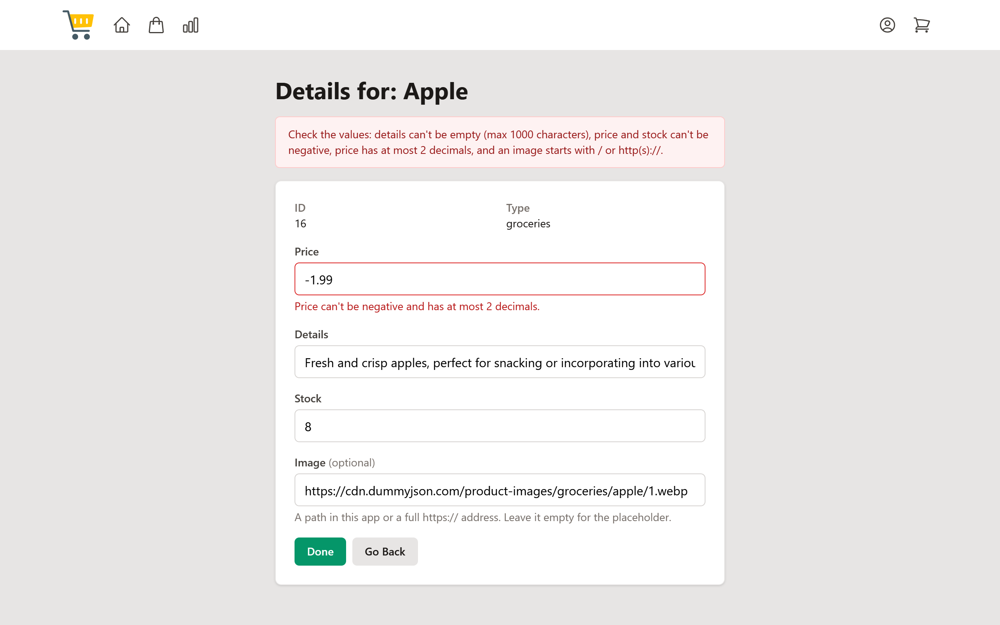](docs/screenshots/13-admin-edit-product.png)<br>**Edit product** · `/edit/{id}` | |

</details>

<!-- markdownlint-enable MD033 -->

## Run it locally

> [!TIP]
> The [docs](docs/README.md) folder holds more technical information available for reading

### What you need

- [JDK 25](https://adoptium.net/) and [Maven 3.9+](https://maven.apache.org/download.cgi)
- [Docker Desktop](https://www.docker.com/products/docker-desktop/), running
- A [Stripe](https://dashboard.stripe.com/register) free account in test mode (no real money moves) and the [Stripe CLI](https://docs.stripe.com/stripe-cli)
- Powershell 7 was used for the commands below:

### 1. Connect Stripe (once)

In the Stripe Dashboard, switch to test mode and copy the secret key from **Developers → API keys**. Then run:

```powershell
$sk = "sk_test_..."   # paste your secret key here
[Environment]::SetEnvironmentVariable("STRIPE_SECRET_KEY", $sk, "User")

# The webhook secret must come from the same account as the key, hence --api-key
$whsec = stripe listen --api-key $sk --print-secret
[Environment]::SetEnvironmentVariable("STRIPE_WEBHOOK_SECRET", $whsec, "User")
```

### 2. Start the shop

From the project folder:

```powershell
# Start the database (PostgreSQL in Docker) in the background
docker compose up -d

# In a second terminal, leave this running: it passes Stripe's payment events to the app
stripe listen --api-key $env:STRIPE_SECRET_KEY --events checkout.session.completed,checkout.session.expired --forward-to localhost:3000/stripe/webhook

# In a third terminal, start the app
mvn spring-boot:run
```

The first start takes a few minutes: Maven downloads its dependencies and a copy of Node to build the stylesheet, and the database is created and filled with the demo data. The shop is ready when the log shows `Started MyApplication`.

### 3. Try it

Open **<http://localhost:3000>** and log in with one of the demo accounts:

| Username | Password | Role |
| --- | --- | --- |
| `owner` | `password` | ADMIN |
| `Phil` | `1234pass` | USER |
| `Joseph` | `josephw0w` | USER |
| `Maria` | `maria2026` | USER |
| `Kenji` | `kenji2026` | USER |

The shop is stocked with DummyJSON's 194 sample products in 24 types. A few are low or out of stock and one is hidden, so every admin view has something to show.

- **As a customer:** browse and filter the catalogue, add a few products to the cart and pay. The order then appears as PAID on your profile.
- **As `owner`:** see that order on the dashboard, mark it as shipped or refund it, and add, edit or hide products.

> [!NOTE]
> Stripe is in test mode, so no real money moves. Pay with the test card `4242 4242 4242 4242`, any future expiry date and any CVC.

### Stop

Press `Ctrl+C` in the app's terminal and in the `stripe listen` terminal, then:

```powershell
docker compose down       # stop the database; accounts and orders are kept
docker compose down -v    # or: stop and wipe it, for fresh demo data on the next start
```

<!-- markdownlint-disable MD033 -- <details> dropdowns need HTML -->

<details>
<summary><strong>If something goes wrong</strong></summary>

- **"STRIPE_SECRET_KEY is not set" when the app starts:** the terminal was opened before step 1. Open a new one.
- **A paid order stays PENDING:** `stripe listen` isn't running, or the key and the webhook secret come from different Stripe accounts. Redo step 1 with `--api-key` as shown.
- **The database won't start, or port 5432 is in use:** another PostgreSQL is running on your machine. Stop it, or stop the other Docker container that uses the port.
- **Flyway reports migrations it doesn't know:** the database was created by an older version of the project. Wipe it with `docker compose down -v` and run `mvn clean` once.
- **Port 3000 is in use:** another copy of the app is still running. Stop it first.

</details>

<!-- markdownlint-enable MD033 -->

## Build a runnable jar
>
> [!IMPORTANT]
> Requires the PostgreSQL db to be running (in a Docker container)

```bash
mvn clean package
java -jar target/johne-0.0.1.jar
```

## Features

<!-- markdownlint-disable MD033 -- <details> dropdowns need HTML -->

<details>
<summary><strong>Show all features</strong>: browsing and buying, payment, order history, and the admin's dashboard, orders and products</summary>

- **Home:** a welcome line, a link to the catalogue and a Featured row with the four best-rated products in stock.
- **Catalogue:** a card grid, open to everyone, with each product's picture (or a placeholder), price and an "Only N left" or "Out of stock" hint. Cards lift slightly on hover. A name search and one chip per type filter the list together, and the count above it follows ("12 of 194"). Products an admin has hidden don't appear, and their pages return 404.
- **Product page:** a large picture in a photo frame, the name, details, price and stock hint. On phones Add To Cart and Buy stay pinned to the bottom of the screen.
- **Add to cart or buy:** Add To Cart stays on the page: a small toast shows the product, and the cart badge in the navbar updates. Buy adds the product and goes straight to checkout. Both buttons are disabled when a product is out of stock.
- **One layout:** every page shares a sticky navbar that marks the current page, and a footer. Everything works on phones, where the navbar's links become icons.
- **Accounts:** registration (username of 3+ characters, password of 8+, unique usernames), login and logout, with visible labels, the password rule shown up front and a message under the field that's wrong.
- **Cart:** one line per product with its picture, price and quantity, "Only N left" and "No longer sold" warnings, and a summary with the total. Adding more than is in stock is blocked.
- **Checkout and payment:** an order summary next to the payment card. "Pay with Stripe" creates a PENDING order with each item's current price and sends the customer to Stripe's hosted payment page. When Stripe's webhook confirms the payment, the stock is taken, the order becomes PAID and those products leave the cart. If the customer never pays, the order is CANCELLED when the session expires. If stock ran out while they were paying, the payment is refunded automatically.
- **Order history:** customers see their past orders, newest first, with dates, items and a colour badge for the status (PENDING, PAID, SHIPPED, CANCELLED, REFUNDED) on their profile.
- **Admin dashboard** (`/owners`): revenue all time and for the last 7 days, order counts by status (each links to the filtered list), the 10 most recent orders next to the 10 emptiest products (with how many are low in total), and a form to add a product.
- **Order management:** every order, 20 per page, filtered with status chips. An order's page shows its items next to its facts and actions, and links to its payment in the Stripe Dashboard. PAID orders can be marked as shipped, or refunded: the money goes back through Stripe and the stock returns to the shelf.
- **Product management:** a product table with thumbnails, the same filters and a count of hidden products. Add and edit products, including an optional picture (a path in the app or an image URL), with server-side validation: a refused edit comes back with what was typed and a message under each failing field. Products can be hidden from the shop and shown again; they're never deleted, so old orders keep showing what was bought.

</details>

<!-- markdownlint-enable MD033 -->

## Then vs Now

<!-- markdownlint-disable MD033 -- <details> dropdowns need HTML -->

<details>
<summary><strong>Show what changed and why</strong>: platform, security, orders and money, payment, admin, frontend, design, seed data, tests</summary>

The original version worked as a demo but had problems that would break a real shop. Open a category to see each change: the old behaviour, what replaced it, and why.

<details>
<summary><strong>Platform</strong>: Spring Boot 2.2 → 4.1, H2 → PostgreSQL with Flyway, feature packages</summary>

| Before | Now | Why |
| --- | --- | --- |
| Spring Boot 2.2.4, Java 13 | Spring Boot 4.1.1, Java 25 | Boot 2.x stopped getting fixes years ago. Moving up also meant switching `javax.*` imports to `jakarta.*`. |
| H2 in-memory database, `ddl-auto=create`, `data.sql` | PostgreSQL in Docker, Flyway migrations, `ddl-auto=validate` | H2 data disappeared on every restart. Now the schema lives in versioned SQL files, and the app refuses to start if the Java entities and the tables disagree. |
| `@Autowired` fields | Constructor injection | Dependencies are explicit and `final`, and the class is easier to test. |
| Every class in one flat package | Feature packages: `admin`, `cart`, `order`, `payment`, `product`, `security`, `user` | Everything about one feature sits together. |

</details>

<details>
<summary><strong>Security</strong>: a session per browser, BCrypt passwords, roles, CSRF protection</summary>

| Before | Now | Why |
| --- | --- | --- |
| The logged-in user was kept in fields on `MainController` (`loggedUser`, `loggedIn`) | Spring Security keeps a session per browser, and the controller reads the user from `Principal` | A controller is a single shared object. When one person logged in, **every visitor** was logged in as them. The admin edit form had the same bug through a shared `tempProduct` field. |
| Plain-text passwords, checked by loading every user and comparing strings | BCrypt hashes, checked by Spring Security | Stored passwords can't be read back. The seed stores BCrypt hashes, made with the same encoder the app uses. |
| `owner` boolean checked inside some handlers; `/owners`, `/product/add` and `/view/orders` had no check | `role` column (`USER`/`ADMIN`); admin URLs locked in `SecurityConfig` | Access rules live in one place and can't be skipped by forgetting an `if`. |
| A "Guest" row in the users table (id 1) stood in for logged-out visitors | Removed; logged out simply means no session | A fake account that every anonymous visitor shared. |
| State changes over `GET` (`/purchase`, `/cart/remove`, add to cart); no CSRF protection | `POST` with a CSRF token (AJAX calls send it in a header) | A link or image on another site could empty a cart or place an order on the user's behalf. |
| No registration rules; duplicate usernames possible | Length rules, `UNIQUE` username in the database, friendly error messages | |

</details>

<details>
<summary><strong>Cart, orders and money</strong>: <code>BigDecimal</code> prices, real orders, stock taken only when payment succeeds</summary>

| Before | Now | Why |
| --- | --- | --- |
| `Double` prices | `BigDecimal` in Java, `NUMERIC(10,2)` in the database | Floating point can't represent values like 0.10 exactly, so totals drift. |
| Cart = a many-to-many list of products; the same product repeated for each copy | `cart_items` table with a `quantity`, one row per user and product | Quantities are real numbers, and adding the same item twice doesn't create duplicate rows. |
| Orders = one flat list of products per user, with no date, status or price | `orders` + `order_items`, each with `created_at`, `status` and the `unit_price` at purchase time | Purchases are grouped, and a later price change doesn't rewrite order history. |
| Stock went down when an item was **added to the cart** (read, subtract, save) | Stock is **checked** at add-to-cart and **taken** when Stripe confirms payment, with one conditional `UPDATE ... WHERE stock >= qty` per line inside a transaction | Abandoned carts no longer lock up stock. Two people buying the last item at the same time can't both succeed. |
| Admin "orders" page listed users and their product lists | Admin sees every order, opens one, and ships it (PAID → SHIPPED) | |

</details>

<details>
<summary><strong>Payment and checkout</strong>: Stripe's hosted page, and a signed webhook that confirms payment</summary>

| Before | Now | Why |
| --- | --- | --- |
| "Confirm Purchase" just moved the cart into orders; the billing form was never saved | Stripe Checkout's hosted page takes the payment; the app never sees card details | Real payments without handling card data, which stays with Stripe. |
| An order counted as done as soon as the button was clicked | The order stays PENDING until a **signed webhook** from Stripe confirms payment | A browser landing on the "thank you" page proves nothing, because anyone can open that URL. Only Stripe's signed event can be trusted. |

</details>

<details>
<summary><strong>Admin</strong>: a dashboard, paged orders, refunds, hidden products, server-side validation</summary>

| Before | Now | Why |
| --- | --- | --- |
| The admin page had Log Out, View Orders and a "Change Orders" button that only went to `/` | A dashboard: revenue, orders by status, low-stock products, recent orders | The numbers come from `COUNT`/`SUM ... GROUP BY` queries mapped straight into records, so the page costs a few small queries however many orders exist. |
| `/view/orders` loaded every order on every visit | 20 per page (`Pageable`), filterable by `?status=` | One page is a `LIMIT/OFFSET` query plus a count, so the page stays fast as orders grow. |
| No refunds; an admin could only ship | Refund for PAID orders: a Stripe refund, then status REFUNDED and the stock goes back | Stripe is called first, with an idempotency key, so clicking again after a failure can never refund twice. CANCELLED still means "never paid", so revenue leaves out both. |
| A product couldn't be removed at all | Products can be hidden and shown again (`active` flag) | `order_items` references products, so deleting one would break order history. Hidden products leave the shop, the cart's checkout and the low-stock list. |
| Bad product input (negative price, empty name) hit a database `CHECK` and showed a 500; a price of `1.999` was silently rounded | Bean Validation on request records; a refused edit form comes back with what was typed and a message under each failing field | The browser's `min`/`step` checks are easy to remove, so the server checks too. The form is shown again rather than redirected, because the list of failing fields (`BindingResult`) doesn't survive a redirect. |
| "Add product" bound the JSON straight to the `Product` entity | A `NewProductRequest` record with no `id` field | A request containing `"id": 3` overwrote product 3 instead of adding a new one. |
| A missing product (`/details/999`) showed a 500 | A 404 page | `ProductNotFoundException` carries `@ResponseStatus(NOT_FOUND)`. |
| The low-stock list showed every product under the threshold | The 10 emptiest, plus how many there are in total | With 194 products the list would have filled the page. A `Limit` parameter and a `countBy...` query keep it to two small queries. |

</details>

<details>
<summary><strong>Frontend</strong>: Bootstrap from CDNs → Tailwind built with Maven, one layout, product cards</summary>

| Before | Now | Why |
| --- | --- | --- |
| Bootstrap 4.5, jQuery, Popper and Font Awesome from CDNs, plus a `style.css` | Tailwind CSS v4, compiled at build time into one `app.css` that only holds the classes the templates use | No third-party downloads at page load. Bootstrap's rules would also beat Tailwind's (Tailwind uses cascade layers), so the two couldn't share a page. |
| Every page repeated its own `<head>`: stylesheets, scripts, favicon | One layout fragment holds the `<head>`, navbar and footer; each page only supplies its title and content | Adding a script or stylesheet is one edit instead of one per page. |
| Text links, and Font Awesome icons for the account and cart links | Heroicons inline SVGs; each icon link's label shows on hover or keyboard focus and is also its accessible name | No icon font to download, and icon-only links still have a name for screen readers. |
| Products in a table; a picture only on the details page, looked up by product name | A card grid; a `product.image` column holds a path or URL, and `NULL` shows a placeholder | 42 of the original 50 products had no file with their exact name, so their pages showed a broken image. |
| Add To Cart reloaded the page with no feedback | It posts with `fetch`; a toast shows the product and the navbar's cart badge updates. A Buy button goes straight to checkout | Customers see what happened without losing their place. Without JavaScript the form still posts normally. |
| Two search boxes (type and name); whichever was typed in last won | One name search plus a chip per type, combined | Customers don't have to know the type names. |
| Prices under €1 showed as "€.99" | "€0.99" | Thymeleaf's `formatDecimal` was told to print at least 0 digits before the point. |
| The first page of a new session linked to `app.css;jsessionid=...` | `server.servlet.session.tracking-modes=cookie` | Spring Security rejects URLs with `;` in them, so that page loaded without its stylesheet or script. |

</details>

<details>
<summary><strong>Design</strong>: Tailwind's placeholder colours → the Etelier look, page by page</summary>

| Before | Now | Why |
| --- | --- | --- |
| Tailwind's default emerald and stone colours and the system font, kept as placeholders | Etelier: a cream canvas, white cards with a 2px border, black ink, mint only as a fill, pill-shaped buttons and chips; Geist for headings, Inter for text | One consistent look, designed as page mockups first and then built page by page. The colours, type sizes, radii and shadows are `@theme` tokens, so a class like `text-heading-xl` carries size, line height and weight together. |
| Fonts from the operating system | Geist and Inter self-hosted (latin subsets, WOFF2), cached for a year | No request to Google Fonts at page load. Spring Security marks every response `no-store`, so `WebConfig` gives `/fonts/**` its own `Cache-Control`. |
| Home was a welcome line | A Featured row with the four best-rated products in stock | The first page shows something to buy. Products without a rating sort last (`NULLS LAST`, which Postgres doesn't do by default for `DESC`). |
| Every button looked equally important (four filled buttons on each admin row) | Graded: one primary per page or row, then outline, grey and ghost buttons; destructive actions as red outlines | The obvious next action stands out, and Refund no longer sits level with Mark as shipped. |
| Order status as plain text ("PAID") | Colour badges: PENDING amber, PAID mint, SHIPPED ink, CANCELLED grey, REFUNDED red | Statuses can be scanned down a long list. |
| Dates like "15 10 2026" | "15 Oct 2026, 14:22" | The pattern was `dd MM yyyy`, which prints the month as a number. |
| The dashboard's all-time revenue in "$" | "€", like every other price | |
| Paging buttons disappeared on the first and last page | Shown disabled | The buttons stay in the same place from page to page. |
| Login and register fields with placeholders only | Visible labels, 44px fields, the password rule shown up front, a message under the field that's wrong | A placeholder disappears as soon as you type, and it isn't a reliable label for screen readers. |
| On phones, the main actions were somewhere down the page | The product page's Add To Cart and Buy, the cart's total and checkout button, and checkout's pay button are pinned to the bottom of the screen | They stay within thumb reach; the page gets bottom padding so the bar never covers content. |
| The navbar didn't show where you were | The current page's link is marked (`aria-current`), including Products on a product's details and edit pages and Admin on the order pages | `MainController` puts the request path in the model, because Thymeleaf 3.1 no longer lets templates read the request. |

</details>

<details>
<summary><strong>Seed data</strong>: 50 hand-made products → DummyJSON's 194</summary>

| Before | Now | Why |
| --- | --- | --- |
| 50 hand-written products in 9 types, 15 with a picture file in `static/images/` | DummyJSON's 194 products in 24 types, all with pictures, plus brand, rating, discount, gallery, tags and 582 reviews | A catalogue big enough to exercise the search, the filters, paging and the layout with long names and real pictures. |
| Seed SQL written by hand | `scripts/dummyjson-to-sql.mjs` writes `V3__dummyjson_products.sql` from DummyJSON's API | The output is committed, so builds and tests never depend on DummyJSON being up. Product ids are DummyJSON's, so new products continue after them. |

</details>

<details>
<summary><strong>Tests and tooling</strong>: 240 tests against a real PostgreSQL, Spotless formatting, migrations squashed</summary>

| Before | Now | Why |
| --- | --- | --- |
| No automated tests; every change was checked by clicking through the site | 240 tests in four layers, run by `mvn verify` (see [Testing](docs/README.md#testing) in the developer guide) | The payment flow has cases nobody clicks through by hand: duplicate webhooks, stock running out mid-payment, two refunds at once. |
| — | Tests run against a real PostgreSQL in Docker (Testcontainers), not an in-memory database | Row locks (`SELECT ... FOR UPDATE`), `CHECK` constraints and the Flyway migrations behave exactly as in the app. An in-memory stand-in would only imitate them. |
| Two refund clicks at the same moment could both put the stock back | `markRefunded` locks the order row, like `completePayment` | Found while writing the tests. Stripe refunded only once (same idempotency key), but the shelf ended up with stock that didn't exist. |
| No formatting rules | Spotless (palantir-java-format) fails the build on unformatted code | Style stops being a review topic. The one big formatting commit is listed in `.git-blame-ignore-revs`, so `git blame` skips it. |
| A migration for every change made along the way | Squashed into V1 (schema), V2 (accounts) and V3 (the DummyJSON catalogue) | Nothing had been deployed, so no database needed the step-by-step history. Three files are easier to read than many that undo each other. |

</details>

</details>

<!-- markdownlint-enable MD033 -->

<!-- markdownlint-disable MD033 -- <details> dropdowns need HTML -->

<details>
<summary><strong>Design notes</strong>: relations, transactions, locking, Stripe calls, refunds and the frontend</summary>

- **Links run from child to parent only** (`CartItem → User`, `OrderItem → Order`, `Review → Product`). A user's cart and orders, and a product's reviews, are loaded through repositories, not through collections on the parent.
- **`spring.jpa.open-in-view=false`:** the database session closes before the template renders. Each query states what it needs with `@EntityGraph`, so a template can't trigger extra hidden queries.
- **Stock is decremented in SQL** (`ProductRepository.decrementStock`), so the check and the update happen in one atomic step. Payments lock products in id order so two of them can't deadlock.
- **Stripe can deliver the same event twice, even at the same time.** `CartService.completePayment` locks the order row (`SELECT ... FOR UPDATE`) and only acts on a PENDING order, so a repeated event never takes stock twice. `markRefunded` does the same for refunds.
- **No database transaction stays open during a Stripe call.** The order is saved first, then the Checkout Session is created, then its id is saved. Refunds run after the stock transaction has rolled back.
- **Amounts go to Stripe in cents** with `movePointRight(2).longValueExact()`, with no floating-point step in between.
- **Admin refunds call Stripe first, then the database.** If the database step fails, the order still says PAID, and clicking Refund again is safe: the same idempotency key makes Stripe return the existing refund. The other order would risk an order marked REFUNDED whose customer never got their money.
- **Paging only fetches to-one relations.** The order list's `@EntityGraph` loads `user` but not `items`. Fetching a collection would make Hibernate page in memory, which loads every row again.
- **The stylesheet is build output.** The Tailwind CLI scans the templates and `code.js` and writes only the classes it finds to `target/classes/static/app.css`. A class name assembled at runtime would never be found, so templates always spell out full class names.
- **Shared looks are components, not copies.** Buttons, inputs, badges, chips, alerts, cards and tables are defined once in `app.css`'s `@layer components`, and repeated markup (product card, picture, filters, status badge) lives in Thymeleaf fragments, so the next redesign edits one place.
- **One URL, two answers for add to cart.** A plain form post redirects back to the products page. `code.js` sends `X-Requested-With: XMLHttpRequest`, which picks a second mapping that answers JSON with the new cart count (409 when there's no stock left). The header decides, not `Accept`, because browsers send `Accept: */*`.
- **The picture rule lives in two places.** A `CHECK` on `product.image` guards the data; `@Pattern` on the form records turns a bad value into a 400 or a form message instead of a database error (500).
- **Admin endpoints live under paths `SecurityConfig` already locks** (for example `POST /edit/{id}/active`). A new path would fall through to "any logged-in user".

</details>

<!-- markdownlint-enable MD033 -->

## Credits

- **Product data and pictures:** [DummyJSON](https://dummyjson.com), a free sample-data API. Pictures are loaded from its CDN.
- **Fonts:** [Geist](https://vercel.com/font) (Vercel) and [Inter](https://rsms.me/inter/) (Rasmus Andersson), both under the SIL Open Font License 1.1, downloaded from Google Fonts.
- **Icons:** [Heroicons](https://heroicons.com) v2.2.0 (MIT).

## To-Do

- Show the product data that's stored but not on any page yet such as brand, rating, discount, the picture gallery, tags and reviews.
- CI (GitHub Actions running `mvn verify`) and automated dependency updates.

## Known limitations

<!-- markdownlint-disable MD033 -- <details> dropdowns need HTML -->

<details>
<summary><strong>Payments and Stripe</strong>: duplicate orders, no stock reservation, card payments only</summary>

- Clicking "Pay with Stripe" twice, or in two tabs, creates two PENDING orders, and each could be paid.
- Stock isn't reserved while the customer is on Stripe's page. If it sells out in that window, the payment is refunded automatically and the order is cancelled.
- An unpaid order stays PENDING until Stripe expires its session (24 hours by default).
- Card payments only. Delayed methods such as bank debits (`checkout.session.async_payment_succeeded`) aren't handled.
- A refund made in the Stripe Dashboard doesn't update the order, because `charge.refunded` isn't handled. Refund from the app instead.
- The "View payment in Stripe" link points at the test-mode Dashboard.
- Locally, webhooks only arrive while `stripe listen` is running. Events missed while it's off aren't replayed.

</details>

<details>
<summary><strong>Shop and products</strong>: hot-linked pictures, discounts not charged, no cart +/−</summary>

- Product pictures are hot-linked from DummyJSON's CDN, so they need an internet connection, and the shop shows broken images if the CDN changes. Pictures are set as a path or URL; there's no upload.
- DummyJSON's discount is stored but neither shown nor charged: customers pay the full price.
- The cart has no +/− controls; items are added one at a time from the products page.
- Registering with a username longer than 50 characters shows a 500 error instead of a message: the length is checked by the database, not the form.
- The add-to-cart toast hides after 4 seconds, even while the pointer is on it.
- Error pages show no cart badge and no current-page mark, because they're rendered outside `MainController`.

</details>

<details>
<summary><strong>Admin</strong>: no refunds after shipping, the 320px navbar, 405 instead of 403</summary>

- SHIPPED orders can't be refunded; returns aren't modelled.
- "Last 7 days" on the dashboard counts orders by when they were placed, not when they were paid (there's no `paid_at` column).
- The admin's navbar scrolls sideways by a few pixels on a 320px-wide screen (customers' fits).
- When a customer tries a POST that's for admins only, the app shows 405 instead of 403: the access-denied page is GET-only, and Spring Security forwards the POST to it.

</details>

<details>
<summary><strong>Build</strong>: uncached stylesheet and script, an npm override</summary>

- `app.css` and `code.js` are sent with `Cache-Control: no-store`, so browsers download them on every page (fonts are cached).
- `package.json` overrides `@parcel/watcher` to 2.6.0 so `npm audit` is clean. Remove the override once a newer Tailwind CLI depends on it.

</details>

<!-- markdownlint-enable MD033 -->
