# Etelier: developer guide

How to work on the code: the tech stack, editing pages live, the tests, the seed data and the database.

> [!NOTE]
> Everything here assumes the shop already runs. If it doesn't yet, follow [Run it locally](../README.md#run-it-locally) in the main README first.

**Contents:** [Tech stack](#tech-stack) · [Live editing](#edit-templates-and-css-without-restarting) · [Testing](#testing) · [Seed data](#the-seed-data) · [Database](#the-database) · [Jar](#build-a-runnable-jar) · [Configuration](#configuration) · [Screenshots](#screenshots)

## Tech stack

| Layer | Choice |
| --- | --- |
| Language | Java 25 (Eclipse Temurin) |
| Framework | Spring Boot 4.1.1 (Spring MVC) |
| Views | Thymeleaf server-side templates with one shared layout; plain JavaScript (`fetch`) for the cart toast and the product filters |
| Styling | Tailwind CSS v4, compiled at build time into one stylesheet (no CDN), with the design's colours, type sizes and radii as `@theme` tokens; Heroicons as inline SVG |
| Fonts | Geist (headings) and Inter (text), self-hosted as WOFF2 and cached for a year |
| Security | Spring Security: form login, BCrypt password hashing, `USER`/`ADMIN` roles, CSRF protection |
| Persistence | Spring Data JPA (Hibernate) |
| Validation | Bean Validation (Hibernate Validator) on request records |
| Database | PostgreSQL 17, running in Docker |
| Schema migrations | Flyway (versioned SQL scripts) |
| Seed data | [DummyJSON](https://dummyjson.com/docs/products)'s product catalogue, turned into a migration by a Node script |
| Build | Maven 3.9; `frontend-maven-plugin` downloads Node and runs the Tailwind CLI during the build |
| Payments | Stripe Checkout (hosted payment page) and a signed webhook, via `stripe-java` |
| Testing | JUnit 6, AssertJ, Mockito, Spring MockMvc with `spring-security-test`, Testcontainers (PostgreSQL 17) |
| Formatting | Spotless: palantir-java-format for Java, whitespace rules for templates, CSS, JS, SQL and properties; checked by `mvn verify` |

## What you need on top of the demo setup

- **Node 24 and npm**, only for the live-CSS loop and the seed script below. Normal builds don't need them: Maven downloads its own copy of Node to build the stylesheet.

## Edit templates and CSS without restarting

```powershell
# Serve templates straight from src/ and don't cache them
mvn spring-boot:run "-Dspring-boot.run.arguments=--spring.thymeleaf.prefix=file:src/main/resources/templates/ --spring.thymeleaf.cache=false"

# In another terminal: rebuild app.css whenever a template or app.css changes
cd src/main/frontend; npm run watch
```

Save, then refresh the browser. Java, `code.js`, image and font changes still need a restart.

> [!WARNING]
> Tailwind only generates classes it finds in saved templates and `code.js`. Always write full class names; a class built from pieces at runtime never reaches the stylesheet.

## Testing

```powershell
mvn verify                          # all 240 tests, then the Spotless format check
mvn test "-Dtest=CartServiceTest"   # one class
mvn spotless:apply                  # reformat the code; run this before verify if the check fails

# Only the tests that need no Docker:
mvn test "-Dtest=OrderTest,SalesTotalsTest,ProductValidationTest"
```

> [!IMPORTANT]
> **Docker must be running:** the tests use a throwaway PostgreSQL 17, never the development database. **No Stripe account is needed:** Stripe is mocked, and the test profile has dummy keys.

<!-- markdownlint-disable MD033 -- <details> dropdowns need HTML -->

<details>
<summary><strong>How the tests are set up</strong></summary>

- **A real database per run.** Testcontainers starts PostgreSQL 17 on a random port and Flyway migrates it, so every run also checks the migrations against an empty database.
- **Nothing reaches Stripe.** `StripeClient` is a Mockito mock in every Spring test, and `src/test/resources/application-test.properties` supplies dummy keys. If `STRIPE_SECRET_KEY` / `STRIPE_WEBHOOK_SECRET` are set, Spring uses them instead (environment variables beat properties files); the tests work either way.
- **All Spring tests share one context and one container.** The `@SpringBootTest` classes carry identical annotations and mock beans, so Spring builds the application once. MockMvc is built from that context in each class instead of with `@AutoConfigureMockMvc`, which would start a second one.
- **Tests work alongside the seed data instead of relying on it.** They create their own `Test ...` products and `test-...` users, check properties of the result ("contains mine", "sorted", "one more than before") rather than exact seed contents, and delete their rows afterwards.
- **Tests read configured values** (the low-stock threshold, the number of featured products) instead of repeating them, so changing a setting can't turn the build red.
- **Every page test renders its template.** MockMvc runs Thymeleaf, so a broken expression fails the test even though no test looks at the HTML; the tests check the model the page is given.

</details>

<details>
<summary><strong>What each layer tests</strong>: 62 unit, 38 repository, 14 service and 126 web tests</summary>

| Layer | Classes | What they prove |
| --- | --- | --- |
| Unit (62 tests, no Spring) | `OrderTest`, `SalesTotalsTest`, `ProductValidationTest` | Every order status change allowed or refused; revenue sums; every validation limit on the product records, at the boundary, including the picture path rule |
| Repository (38, `@DataJpaTest`) | `ProductRepositoryTest`, `ReviewRepositoryTest`, `OrderRepositoryTest`, `CartItemRepositoryTest` | The conditional stock `UPDATE` (enough, the last unit, not enough), the shop list, the featured list (best rated first, unrated last, no hidden or sold-out products), the low-stock list and its count, paging by status, the dashboard aggregates, the cart count, reviews newest first, the picture and rating `CHECK`s, and that every local picture path names a real file (case included) |
| Service (14, `@SpringBootTest`) | `CartServiceTest`, `MyApplicationTests` | Cart → PENDING order → PAID with real commits and rollbacks: stock taken once, everything rolled back when stock runs out, and a second refund waits for the first one's row lock |
| Web (126, MockMvc) | `PaymentWebTest` | The webhook with real signatures (valid → 200; wrong secret, changed body or missing header → 400), a duplicate event taking stock once, the automatic refund when stock ran out, the admin refund's idempotency key |
| | `SecurityConfigTest` | Every admin URL sends visitors to `/login` and refuses customers with 403; a POST without a valid CSRF token is refused, even for an admin; the stylesheet and every font it names are public, and fonts are cached for a year |
| | `MainControllerTest` | 404 for missing and hidden products, 400 for bad JSON or an unknown status, the edit form shown again with the failing field marked, 409 for shipping or refunding an order in the wrong state; the add-to-cart JSON (new count, 409 without stock), Buy landing on checkout, the cart count and the current path (for the navbar) on every page, Home's featured products, the type chips and the hidden count, the cart total, the profile's orders newest first, the dashboard's low-stock list, the order list's filter and pages, every status's order page, setting and clearing a picture |

</details>

<!-- markdownlint-enable MD033 -->

## The seed data

Besides pictures, each of the 194 products has a brand, rating, discount, gallery and tags, and there are 582 reviews. Four products are out of stock, several are at or below the low-stock threshold, and one (a duplicate "Rolex Cellini Moonphase") is hidden, so every part of the dashboard and the admin list has something to show.

`V3__dummyjson_products.sql` is generated and committed, so builds and tests never call DummyJSON. To regenerate it (only for a fresh database, because Flyway refuses an applied migration that changed):

```powershell
node scripts/dummyjson-to-sql.mjs
docker compose down -v; mvn clean
```

## The database

```bash
docker compose exec db psql -U shop -d shop    # open psql on the development database
docker compose down -v                         # wipe it; Flyway rebuilds it from V1 on the next start
```

Useful commands inside psql: `\dt` (list tables), `\d orders` (describe a table), `SELECT * FROM flyway_schema_history;` (applied migrations), `\q` (quit).

A database created before the migrations were squashed into V1-V3 won't start: Flyway finds migrations it no longer has. Wipe it once with `docker compose down -v`, and run `mvn clean` so old migration files don't linger in `target/classes`. Never edit an applied migration; add a `V4__...` instead, and change the entity with it (`ddl-auto=validate` checks they match).

## Build a runnable jar

```bash
mvn clean package
java -jar target/johne-0.0.1.jar
```

## Configuration

| Setting | Default | Notes |
| --- | --- | --- |
| HTTP port | `3000` | `server.port` in `application.properties` |
| Database | `localhost:5432`, db/user `shop` | matches `compose.yaml` |
| `DB_PASSWORD` env var | `devpassword` | local-only default; set the variable to override it |
| `APP_BASE_URL` env var | `http://localhost:3000` | where Stripe sends the customer back after paying or cancelling |
| `STRIPE_SECRET_KEY`, `STRIPE_WEBHOOK_SECRET` env vars | none | required; the app refuses to start unless they start with `sk_` and `whsec_` |
| `app.low-stock-threshold` | `13` | "Only N left" hints, Low badges and the dashboard's low-stock list |

## Screenshots

Every page with the seed data, logged in as a customer (Kenji) or as `owner`, with the URL and the template that renders it. Click an image for full size. The products page, on a desktop and on a phone, is at the top of the [main README](../README.md).

<!-- markdownlint-disable MD033 -- <br> puts each caption under its image -->

### Shop

| | |
| :---: | :---: |
| [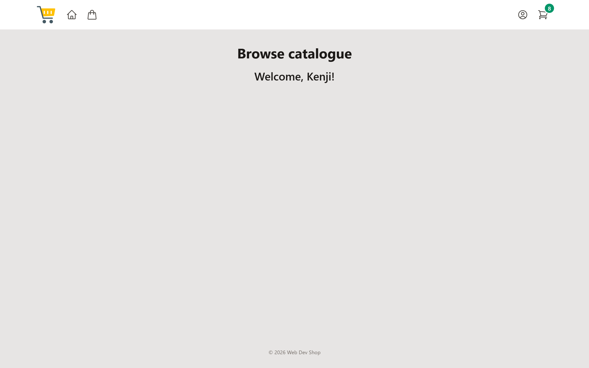](screenshots/01-home.png)<br>**Home** · `/` · `index.html` | [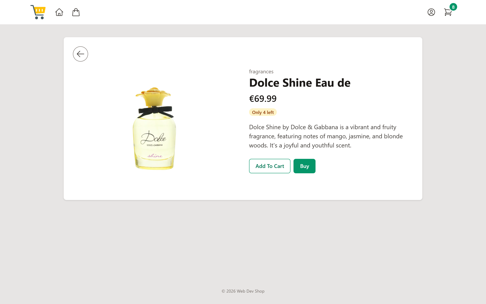](screenshots/03-product-details.png)<br>**Product details** · `/details/{id}` · `details.html` |
| [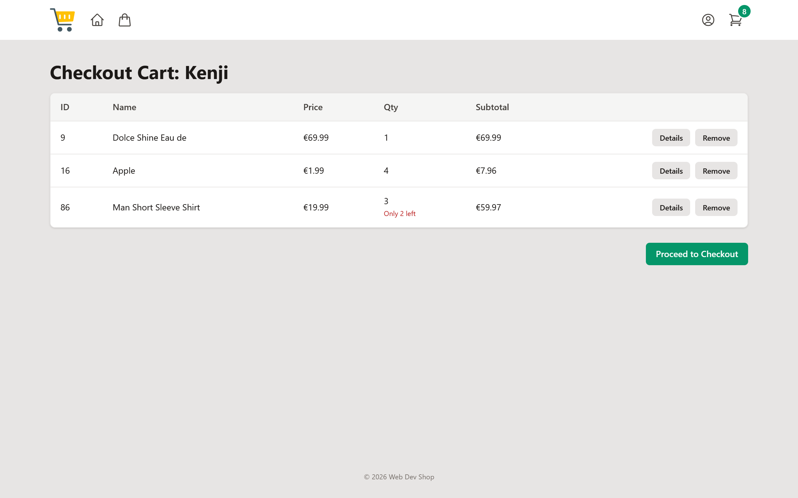](screenshots/04-cart.png)<br>**Cart** · `/cart` · `cart.html` | [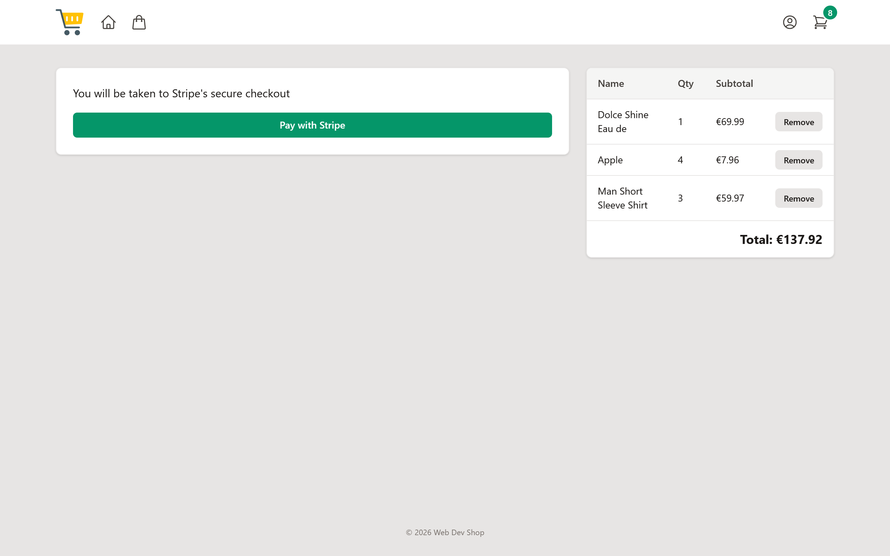](screenshots/05-checkout.png)<br>**Checkout** · `/checkout` · `checkout.html` |
| [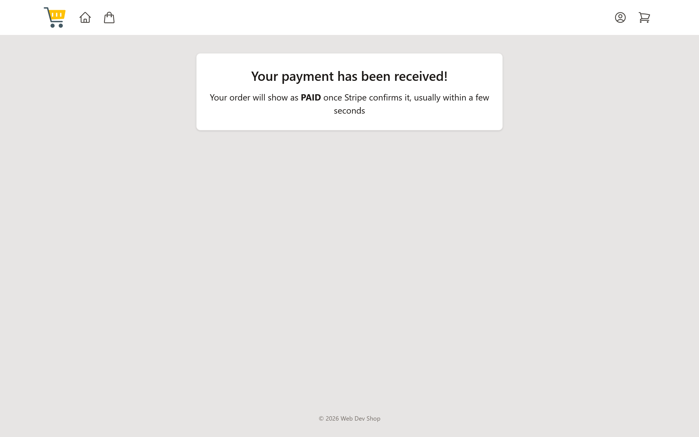](screenshots/06-purchase-success.png)<br>**Payment received** · `/purchase` · `purchase.html` | [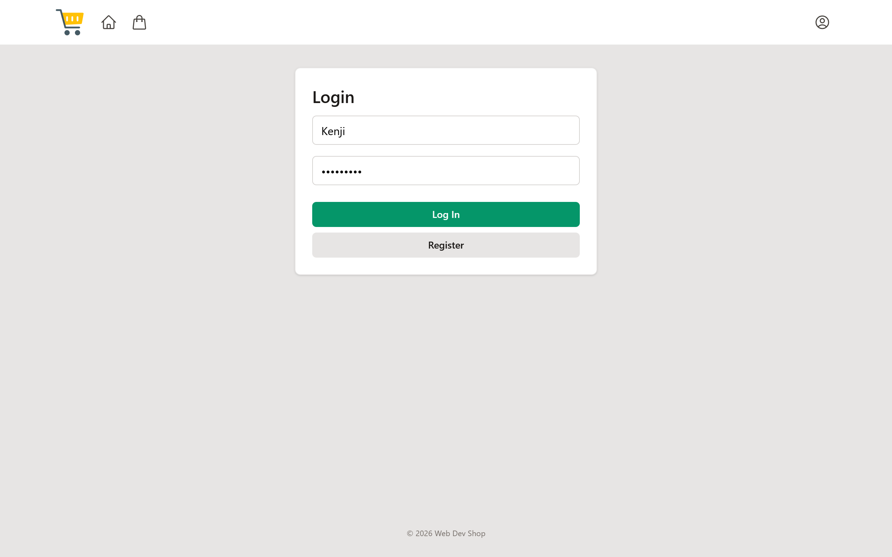](screenshots/07-login.png)<br>**Log in** · `/login` · `login.html` |
| [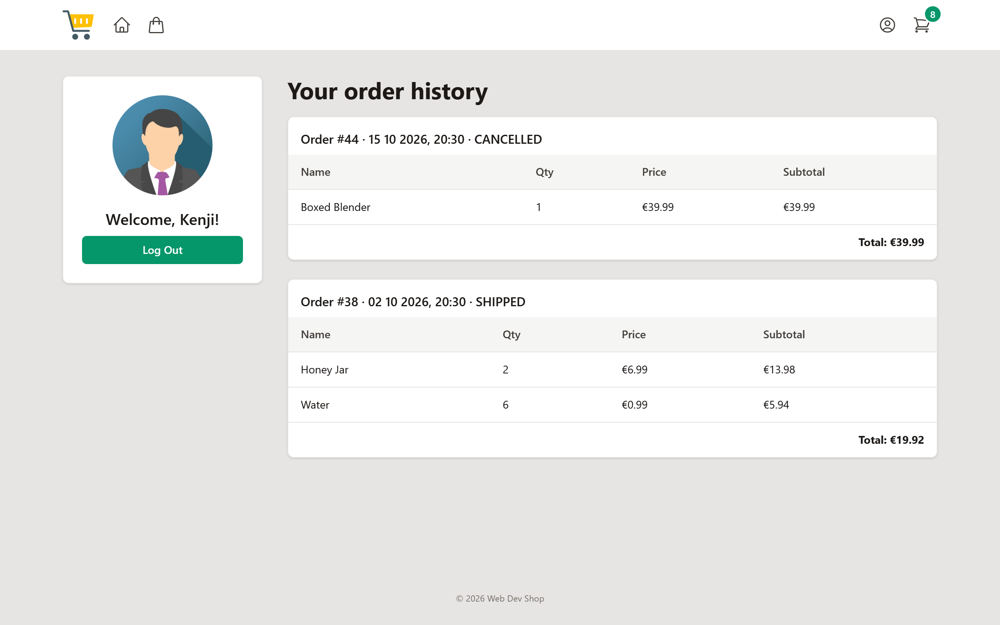](screenshots/08-profile.png)<br>**Order history** · `/profile` · `profile.html` | |

### Admin

| | |
| :---: | :---: |
| [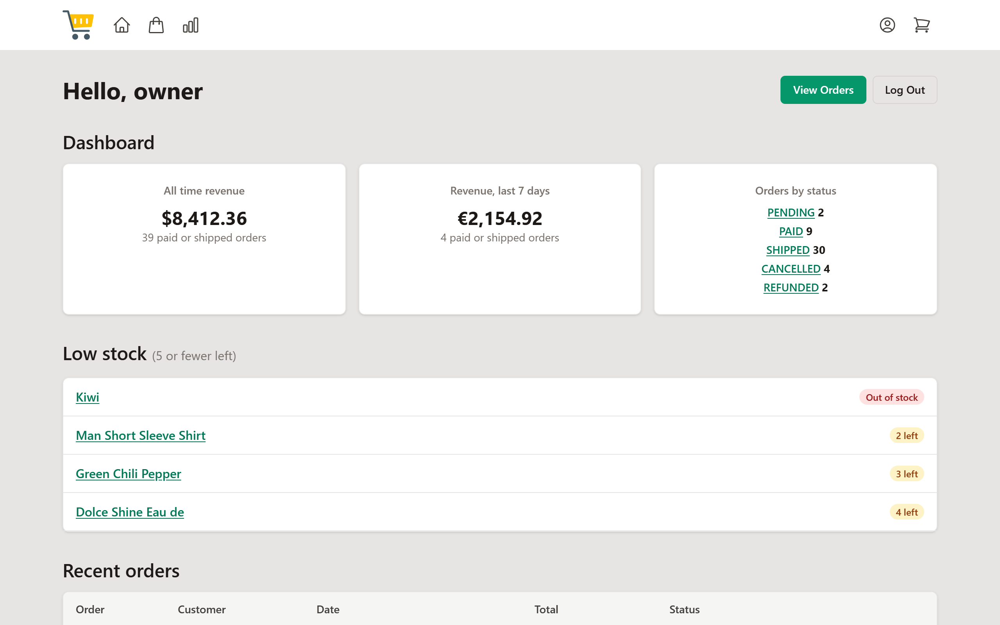](screenshots/09-admin-dashboard.png)<br>**Dashboard** · `/owners` · `owners.html` | [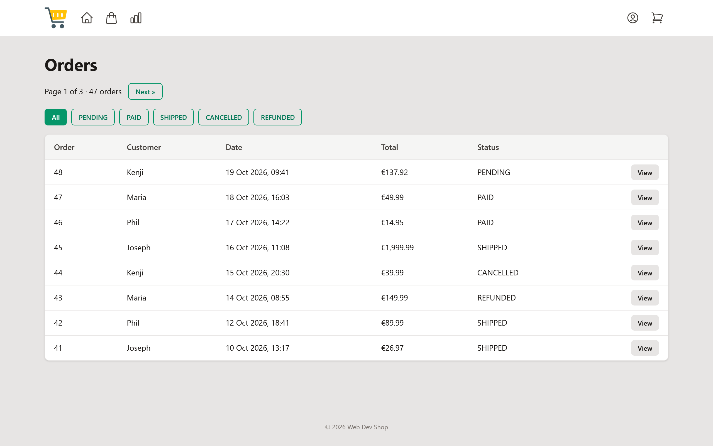](screenshots/10-admin-orders.png)<br>**Orders** · `/view/orders` · `view_order.html` |
| [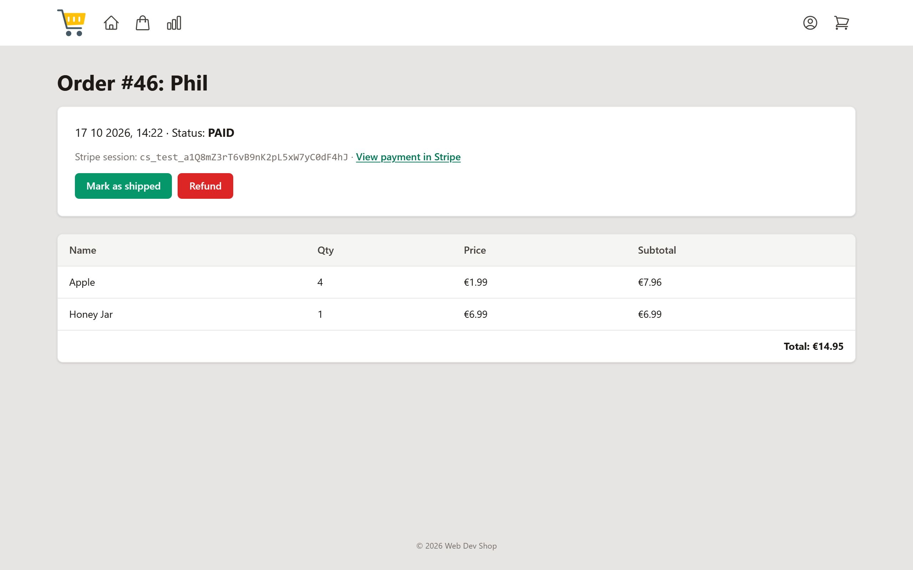](screenshots/11-admin-order.png)<br>**Order** · `/orders/{id}` · `orders.html` | [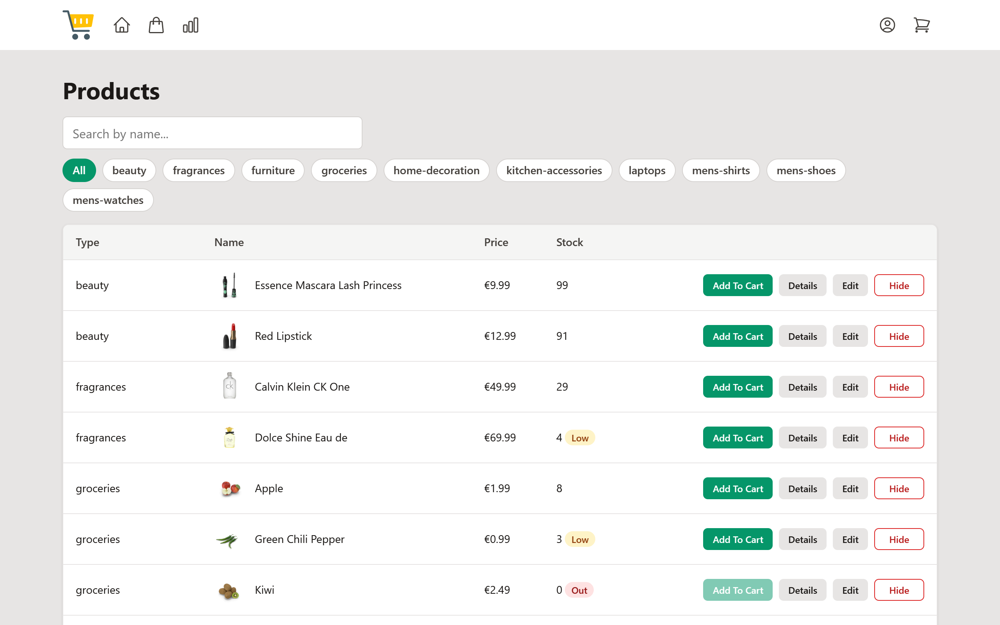](screenshots/12-admin-products.png)<br>**Manage products** · `/products` · `products_owner.html` |
| [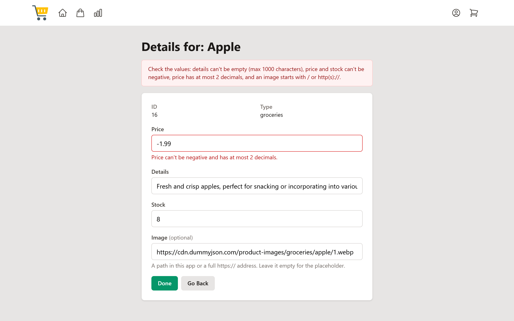](screenshots/13-admin-edit-product.png)<br>**Edit product** · `/edit/{id}` · `edit.html` | |

<!-- markdownlint-enable MD033 -->
